<picture>
  <source media="(prefers-color-scheme: dark)" srcset="assets/hero-dark.svg">
  
</picture>

<picture>
  <source media="(prefers-color-scheme: dark)" srcset="assets/cell-2-dark.svg">
  
</picture>

I study **Data Science at Air University** and work as a **Front-End AI Engineering Intern at FlyRank AI**. I build products end to end, from the interface to the data behind it, and I'm learning how language models work on the inside.

- 🎓 **BS Data Science**, Air University, class of 2030
- 💼 **Front-End AI Engineering Intern**, FlyRank AI (remote)
- 🛠️ **Freelance web & app development**: I handle the business side at [Havlen](https://havlen-studio.vercel.app/)
- 🧠 **Interpretability**: taking GPT-2 apart to see which attention heads do the work
- 🏆 **Hackathons** at NUST and FAST
- ⚽ **NaSCon '26 app dev competition**: built [Sports Management App](https://github.com/hafeee44-lab/Nascon-ijtemai-kaavish) with a team of three. I worked on the mobile UI/UX and wrote a Selenium Grid, Appium and k6 test harness

<picture>
  <source media="(prefers-color-scheme: dark)" srcset="assets/cell-3-dark.svg">
  
</picture>

  <a href="https://github.com/haiderimran019/Solvane"><picture>
    <source media="(prefers-color-scheme: dark)" srcset="assets/card-solvane-dark.svg">
    
  </picture></a>
  <a href="https://github.com/haiderimran019/Riyadh-as-Saliheen"><picture>
    <source media="(prefers-color-scheme: dark)" srcset="assets/card-riyadh-dark.svg">
    
  </picture></a>
  <a href="https://github.com/haiderimran019/Gpt2-ioi-Mechinterp"><picture>
    <source media="(prefers-color-scheme: dark)" srcset="assets/card-gpt2-dark.svg">
    
  </picture></a>
  <a href="https://github.com/haiderimran019/Sales-Data-Dashboard"><picture>
    <source media="(prefers-color-scheme: dark)" srcset="assets/card-sales-dark.svg">
    
  </picture></a>
  <a href="https://havlen-studio.vercel.app/"><picture>
    <source media="(prefers-color-scheme: dark)" srcset="assets/card-havlen-dark.svg">
    
  </picture></a>
  <a href="https://github.com/hafeee44-lab/Nascon-ijtemai-kaavish"><picture>
    <source media="(prefers-color-scheme: dark)" srcset="assets/card-nascon-dark.svg">
    
  </picture></a>

Try them: <a href="https://havlen-studio.vercel.app/">Havlen Studio</a> · <a href="https://haiderimran019.github.io/Riyadh-as-Saliheen/">Riyad as-Salihin</a> · <a href="https://haiderimran019.github.io/Sales-Data-Dashboard/">Sales Dashboard</a> · <a href="https://haiderimran019.github.io/Solvane/">Solvane</a> · <a href="https://github.com/haiderimran019/Gpt2-ioi-Mechinterp/blob/main/output/pdf/gpt2_ioi_research_paper.pdf">GPT-2 paper (PDF)</a> · <a href="https://github.com/hafeee44-lab/Nascon-ijtemai-kaavish">Sports Management App</a>

<!-- Hisaab freelancer finance -->

  <a href="https://github.com/haiderimran019/Hisaab"><picture>
    <source media="(prefers-color-scheme: dark)" srcset="assets/card-hisaab-dark.svg">
    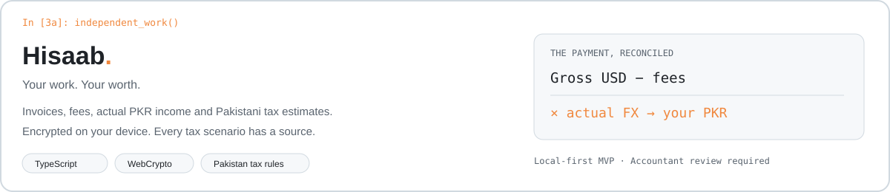
  </picture></a>

**[Hisaab](https://github.com/haiderimran019/Hisaab)** · **[Open public app](https://haiderimran019.github.io/Hisaab/)** — A local-first finance tool for Pakistani freelancers, with invoices, multi-currency receipts, actual FX and fee reconciliation, expense evidence, and source-linked FBR tax estimates for TY2026/2027. Uses TypeScript, Decimal.js, Zod and WebCrypto. Encrypted backups, eligibility checks and 27 passing tests; provincial and specialist tax cases require review. No bank integration or IRIS submission.

<picture>
  <source media="(prefers-color-scheme: dark)" srcset="assets/cell-4-dark.svg">
  
</picture>

<picture>
  <source media="(prefers-color-scheme: dark)" srcset="assets/stack-dark.svg">
  
</picture>

<picture>
  <source media="(prefers-color-scheme: dark)" srcset="assets/cell-5-dark.svg">
  
</picture>

- Building my **FlyRank AI capstone** in React + TypeScript
- Running the **Solvane** pilot and improving the browser extension
- Preparing for the next hackathon at **NUST / FAST**

<picture>
  <source media="(prefers-color-scheme: dark)" srcset="assets/cell-6-dark.svg">
  
</picture>

  Have a website or app you need built? I'd like to hear about it.
    
  <a href="mailto:thehaiderimran19@gmail.com"><b>Email</b></a> &nbsp;·&nbsp;
  <a href="https://www.linkedin.com/in/haider-imran-558010423/"><b>LinkedIn</b></a> &nbsp;·&nbsp;
  <a href="https://havlen-studio.vercel.app/"><b>Havlen</b></a>

<picture>
  <source media="(prefers-color-scheme: dark)" srcset="assets/footer-dark.svg">
  
</picture>
