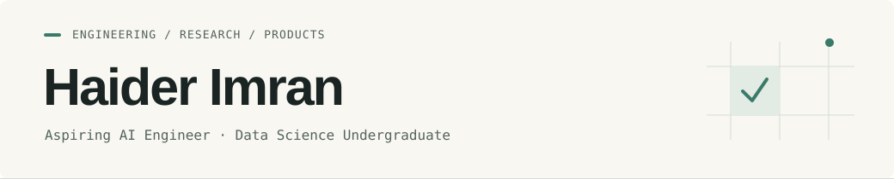

  

  <strong>AI engineering · Model interpretability · Software products · Data analytics</strong>

  <a href="https://www.linkedin.com/in/haider-imran-558010423/">LinkedIn</a>
  &nbsp;·&nbsp;
  <a href="https://github.com/haiderimran019?tab=repositories">Repositories</a>
  &nbsp;·&nbsp;
  <a href="https://github.com/haiderimran019/Gpt2-ioi-Mechinterp/blob/main/output/pdf/gpt2_ioi_research_paper.pdf">Research paper</a>

---

## 01 / About

I'm an **aspiring AI engineer** and **BS Data Science student at Air University**, interested in what makes AI systems work and how to turn technical ideas into useful, reliable software.

I've completed a **Front-End AI Engineering internship at FlyRank AI**. I build applications with AI-assisted development workflows, use Git/GitHub to manage code, and am strengthening my foundations in programming, debugging, model evaluation, and software architecture.

  

## 02 / Selected engineering work

*Research, products, and hackathon collaborations — each linked to its source repository.*

| Project | Engineering focus |
| :--- | :--- |
| **[GPT-2 IOI · Mechanistic Interpretability](https://github.com/haiderimran019/Gpt2-ioi-Mechinterp)** Python · PyTorch · TransformerLens | Replication and audit of GPT-2 Small's indirect-object identification behavior, using activation patching, ablation, and prompt-robustness checks. **[Paper](https://github.com/haiderimran019/Gpt2-ioi-Mechinterp/blob/main/output/pdf/gpt2_ioi_research_paper.pdf)** |
| **[ER Command · AICON '26, NUST](https://github.com/hafeee44-lab/aicon26-er-dashboard)** Next.js · React · Tailwind CSS | **Team project — frontend contributor.** Created initial dashboard screens and state management; contributed patient overview and care-team interface designs. The project supports AI-assisted intake, rule-based triage, and care-task escalation. **[Demo](https://aicon26-er-dashboard-taupe.vercel.app/)** |
| **[Hisaab · Private Bookkeeping](https://github.com/haiderimran019/Hisaab)** TypeScript · Supabase · On-device AI | Privacy-focused bookkeeping for Pakistani freelancers with encrypted records, multilingual guided workflows, and optional local AI. Hosted features remain in a limited pilot. **[App](https://haiderimran019.github.io/Hisaab/)** |
| **[Sales Data Analytics · Autoboard](https://github.com/haiderimran019/Sales-Data-Dashboard)** React · TypeScript · Forecasting | Analytics dashboard with out-of-sample model evaluation and transparent forecast error reporting. Documented revenue holdout result: **18.8% MAPE** on the project's dataset. **[Dashboard](https://haiderimran019.github.io/Sales-Data-Dashboard/)** |
| **[Ijtemai Kaavish · NaSCon '26](https://github.com/hafeee44-lab/Nascon-ijtemai-kaavish)** React Native · TypeScript · NestJS · PostgreSQL · Redis | **Team hackathon project; frontend contributor.** I implemented role-aware mobile navigation and responsive matchday themes, and improved accessibility, live-score feedback, and automation-ready test IDs. |
| **[Riyad as-Salihin · Reading Platform](https://github.com/haiderimran019/Riyadh-as-Saliheen)** React · TypeScript · Node.js | Ad-free Quran and hadith reading platform featuring translations, reading progress, bookmarks, and prayer times. **[App](https://riyad-as-salihin.vercel.app/)** |
| **[Solvane · AI Project Continuity](https://github.com/haiderimran019/Solvane)** TypeScript · React · Local-first | Reviewable project memory and portable handoffs for carrying goals, decisions, and next steps between AI conversations. **[App](https://haiderimran019.github.io/Solvane/)** |
| **[Still Board · Focused Planning](https://github.com/haiderimran019/still-board)** Expo · TypeScript · Web | Minimal note and task board with browser and mobile experiences, developed with documented Agile planning and testing. **[Web app](https://haiderimran019.github.io/still-board/app/)** |

---

## 03 / Experience & education

| | |
| :--- | :--- |
| **FlyRank AI** | Front-End AI Engineering Intern · **Completed** |
| **Air University** | BS Data Science · **In progress** |

## 04 / GitHub contributions

Submitted open-source pull requests; these are currently open and not yet merged.

- **[Clicky PR #152](https://github.com/farzaa/clicky/pull/152):** Added bearer-token protection and fail-closed configuration for the Worker proxy, safer error handling, secure local token storage, regression tests, and CI.
- **[LiteLLM PR #49615](https://github.com/BerriAI/litellm/pull/49615):** Added a Personal Models multi-select filter to the internal users table, with matching across results, totals, pagination, and sorting, plus backend and dashboard tests.
- **[Supabase PR #52651](https://github.com/supabase/supabase/pull/52651):** Hardened the Studio Assistant’s generated RLS helper with a private schema, fixed `search_path`, schema-qualified objects, and least-privilege grants.
- **[Supabase PR #52653](https://github.com/supabase/supabase/pull/52653):** Fixed Studio’s Realtime publication controls so all-table publications remain enabled, including when working outside the `public` schema.

## 05 / Hackathons

- **NUST — AICON '26:** Built the ER Command dashboard as part of a team.
- **NaSCon '26:** Contributed mobile frontend work to Ijtemai Kaavish; the team placed **10th of 70 teams**.

## 06 / AI Training & Certifications

- **OpenAI Academy — Scope AI Solutions** · **Claude — Claude 101 and Claude Code in Action**

## 07 / Tools & direction

| Area | Focus |
| :--- | :--- |
| **Programming foundation** | C++ · Software fundamentals · Debugging |
| **Project technologies** | Python · PyTorch · React · TypeScript · SQL-backed systems |
| **Development workflow** | Claude Code · Codex · Git/GitHub · Testing and documentation |
| **Exploring** | Machine learning · Interpretability · AI engineering · Applied data science |

---

Interested in thoughtful engineering, verifiable results, and software that solves real problems. · [Connect on LinkedIn](https://www.linkedin.com/in/haider-imran-558010423/)
