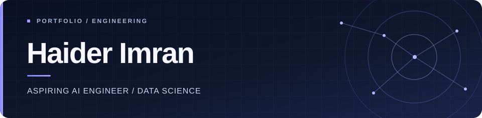

  

I’m a **Data Science undergraduate at Air University** working toward AI engineering. I build and study software at the intersection of **machine learning, model interpretability, data analytics, and useful products**.

Previously, I completed a **Front-End AI Engineering internship at FlyRank AI**. I enjoy using AI coding tools to ship applications while developing stronger foundations in software engineering and ML.

[LinkedIn](https://www.linkedin.com/in/haider-imran-558010423/) · [Research paper](https://github.com/haiderimran019/Gpt2-ioi-Mechinterp/blob/main/output/pdf/gpt2_ioi_research_paper.pdf) · [All repositories](https://github.com/haiderimran019?tab=repositories)

---

## Selected work

### [GPT-2 IOI — Mechanistic Interpretability](https://github.com/haiderimran019/Gpt2-ioi-Mechinterp)
A replication and audit of GPT-2 Small on indirect object identification, using activation patching and ablation to examine which components influence model predictions. Includes robustness checks under changes to prompt wording and names.

**Focus:** `Python` · `PyTorch` · `TransformerLens` · [Paper](https://github.com/haiderimran019/Gpt2-ioi-Mechinterp/blob/main/output/pdf/gpt2_ioi_research_paper.pdf)

### [Hisaab — Private Bookkeeping](https://github.com/haiderimran019/Hisaab)
A privacy-focused finance workspace for Pakistani freelancers. Features encrypted bookkeeping, multilingual guided interactions, deterministic financial calculations, and an optional on-device AI assistant. Its cloud features remain in a limited pilot.

**Focus:** `TypeScript` · `Supabase` · `On-device AI` · [Live app](https://haiderimran019.github.io/Hisaab/)

### [Sales Data Analytics — Autoboard](https://github.com/haiderimran019/Sales-Data-Dashboard)
A browser-based analytics dashboard with forecasting and reproducible out-of-sample validation. The documented revenue model achieved **18.8% holdout MAPE** on its project dataset, with error and uncertainty reported alongside predictions.

**Focus:** `React` · `TypeScript` · `Forecasting` · [Live dashboard](https://haiderimran019.github.io/Sales-Data-Dashboard/)

### [Solvane — AI Project Continuity](https://github.com/haiderimran019/Solvane)
A local-first workspace for carrying reviewed project goals, decisions, constraints, and next steps between AI conversations. Supports version history, portable handoffs, and user-approved updates.

**Focus:** `TypeScript` · `React` · `Browser storage` · [Live app](https://haiderimran019.github.io/Solvane/)

### [Still Board — Focused Planning](https://github.com/haiderimran019/still-board)
A minimal planning board with a browser experience and an Expo mobile application. Designed through a documented Agile workflow, including sprint plans, testing, and product decisions.

**Focus:** `Expo` · `TypeScript` · `Product development` · [Web app](https://haiderimran019.github.io/still-board/app/)

---

## Experience & learning

- **Education:** BS Data Science, Air University.
- **Experience:** Completed Front-End AI Engineering internship at **FlyRank AI**.
- **Hackathons:** Participated at **NUST** and **FAST**; placed **10th** in a FAST app development competition.
- **Courses & certifications:** **Claude 101** and **Claude Code in Action**.
- **Development workflow:** C++, Git/GitHub, Claude Code, Codex, testing, debugging, and project documentation.

**Currently exploring:** Machine learning · Model interpretability · AI engineering · Data-driven software

---

Built with curiosity, iteration, and an emphasis on verifiable work.
