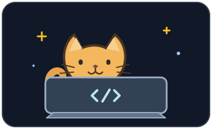

# Hey, I'm Haider 👋

I study **Data Science at Air University** and work as a **Front-End AI Engineering Intern at FlyRank AI**.

I like building web apps, exploring how AI works, and turning everyday problems into simple products. I'd like to start a company one day, so for now I'm learning by making things and putting them into the world.

### Right now

- Learning data science and machine learning.
- Building interfaces with React and TypeScript.
- Exploring ideas around personal finance and calmer ways to organize work.

### A few things I've made

- [Hisaab](https://github.com/haiderimran019/Hisaab) — a local-first finance tool for Pakistani freelancers.
- [Task board experiment](https://github.com/haiderimran019/still-board) — a quieter way to plan what to do now and later.
- [GPT-2 IOI study](https://github.com/haiderimran019/Gpt2-ioi-Mechinterp) — an exploration of how a language model handles a specific reasoning task.

Thanks for stopping by. You can also find me on [LinkedIn](https://www.linkedin.com/in/haider-imran-558010423/).
